# Academic Project Report

---

# AIR HOCKEY: REAL-TIME 2D LAN MULTIPLAYER & ADAPTIVE SIMULATION ENGINE

**Department of Computer Applications**  
**Master of Computer Applications (MCA)**  
**Course Code / Subject:** Mini Project / Advanced Systems & Software Engineering  
**Academic Year:** 2026–2027  

---

### Project Team & Contribution Matrix

| Roll No. | Student Name | Assigned Engineering Role | Assigned Modules |
| :--- | :--- | :--- | :--- |
| **MCA-2026-01** | Team Member 1 (Lead) | **Network & Systems Architect** | `main.c`, `net.c`, `protocol.h`, `features.h` |
| **MCA-2026-02** | Team Member 2 | **Physics & Simulation Engineer** | `game.c`, `trajectory.c`, `input.c` |
| **MCA-2026-03** | Team Member 3 | **Graphics & Audio DSP Engineer** | `render.c`, `audio.c`, `dynaudio.c`, `particles.c` |
| **MCA-2026-04** | Team Member 4 | **Solo Mode & Data Systems Engineer**| `solomode.c`, `replay.c`, `stats.c`, `heatmap.c`, `settings.c` |

**Under the Guidance of:**  
*[Faculty Guide / Department Professor Name]*  
**Department of Computer Applications**  
**Date of Submission:** November 2026  

---

## Chapter 1: Motivation Behind the Project

The motivation behind developing this Air Hockey simulation engine stems from a strong desire to explore low-level systems programming, real-time physics, and network engineering from the ground up using pure **C11**.

The core motivations guiding this project are:

* **Mastering Low-Level Systems and Memory Control:** Gaining deep, practical expertise in manual memory management, pointer arithmetic, and direct hardware execution without relying on automated garbage collectors or heavy runtime abstractions.
* **Building a Real-Time Multiplayer Network Engine:** Understanding and implementing real-time client-server communication using raw TCP sockets, focusing on non-blocking network I/O, custom packet serialization, and synchronized gameplay across multiple machines with zero lag.
* **Implementing Physics and Mathematics from First Principles:** Understanding how game mechanics function under the hood by implementing 2D vector mathematics, elastic collision resolution, and sub-stepped physics integration directly using mathematical formulas rather than a pre-built physics engine.
* **Creating a Lightweight, Self-Contained Application:** Engineering an ultra-lightweight, efficient application (under 10 MB) that requires zero external asset files—generating all visual effects, particle systems, and audio waveforms procedurally in code through digital signal processing (DSP).
* **Developing Seamless Cross-Platform Portability:** Writing clean, standard C code that compiles natively on both Linux (POSIX) and Windows (Winsock2), allowing different operating systems to connect and play together seamlessly over a local area network.

By focusing on these core engineering motivations, this project delivers a robust, self-contained, and performant real-time sports simulation engine that unifies mathematical modeling, network synchronization, and systems programming into a single cohesive system.

---

## Chapter 2: Project Objectives

The primary objectives of this project include:

* **Sub-Stepped 2D Physics Engine:** Implement continuous collision detection (CCD) with up to 6 micro-steps per frame to prevent high-speed tunneling, along with momentum transfer ("flick shots") and Magnus effect curve spin physics.
* **Host-Authoritative LAN Multiplayer:** Design a zero-desync client-server architecture over cross-platform TCP sockets (POSIX on Linux/macOS and Winsock2 on Windows, port `50505`) with non-blocking I/O ensuring the 60 FPS game loop never stalls.
* **Solo Mode Opponent Mechanics:** Develop an autonomous state machine (`DEFEND`, `INTERCEPT`, `ATTACK`, `STRIKE`) in Solo Mode that dynamically learns player scoring tendencies, featuring predictive cushion raycasting and spatial habit adaptation.
* **100% Procedural Audio DSP:** Synthesize all sound effects directly in RAM using raw 44.1 kHz PCM waveforms (sine waves, white noise, and exponential decay envelopes), removing all external audio file dependencies.
* **Esports Telemetry & Polish:** Provide high visual juice with a static 512-particle pool, live $24 \times 32$ court heatmaps, instant slow-motion replay circular ring buffers, and 4 arena themes.

---

## Chapter 3: System Architecture & Flowcharts

The project architecture is structured around a decoupled layer design. Every critical responsibility—from network packet serialization to physical sub-stepping and waveform synthesis—is isolated in specialized modules to maintain stability, zero memory leakage, and deterministic 60 FPS performance.

### 3.1 High-Level Architecture Overview

The software architecture establishes a clear separation between the Host (which acts as server and authoritative physics simulator) and the Client (which acts as a thin input/output terminal). The Host runs the core game loop, accepts client paddle targets, computes all physics and collisions, and replicates the resulting world snapshot to the client.

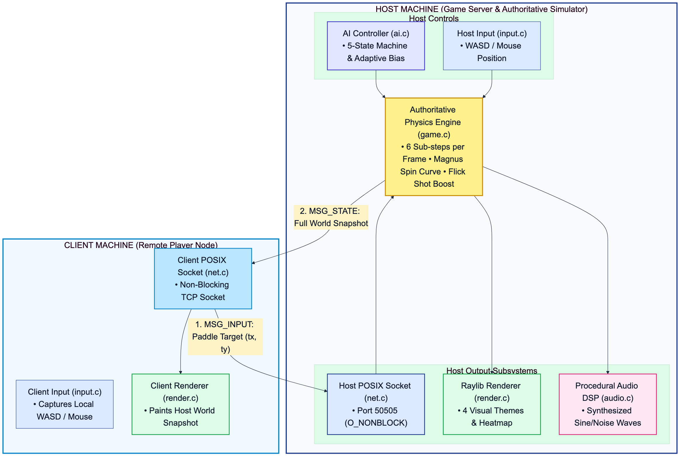  
**Figure 3.1: High-Level System Architecture (Mermaid Flowchart)**  
*Illustrates the interaction between Client Input, Network Sockets, Host Physics Engine, Solo Mode Opponent Controller, Procedural Audio DSP, and Raylib Rendering.*

---

### 3.2 Multiplayer Synchronization Sequence & Protocol

To prevent desynchronization in real-time LAN play, the network engine employs a Host-Authoritative synchronization protocol over non-blocking cross-platform TCP sockets on port `50505`.

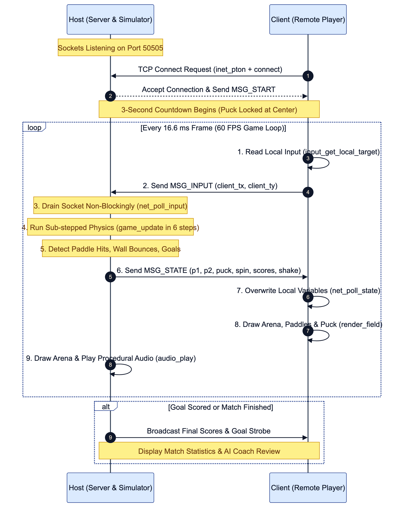  
**Figure 3.2: Network Communication & Frame Synchronization (Mermaid Sequence Diagram)**  
*Details the handshake, 3-second countdown lock, client input transmission (`MSG_INPUT`), and host authoritative snapshot broadcast (`MSG_STATE`).*

**Key aspects of the synchronization protocol:**
1. **Handshake Phase:** When the client connects, the host accepts the connection via `accept()`, sets the socket to `O_NONBLOCK`, and transmits a `MSG_START` packet. Both machines start a 3-second countdown timer during which puck physics are stationary.
2. **Client Transmission:** On every 16.6 ms frame, the client reads its local keyboard/mouse input and transmits a 12-byte `MSG_INPUT` packet containing `(client_tx, client_ty)`.
3. **Host Authoritative Step:** The host drains all incoming client packets using `net_poll_input()`, applies the client target to Player 2's paddle, runs the physics engine across 6 sub-steps, and transmits a 56-byte `MSG_STATE` snapshot.
4. **Non-Blocking Resilience:** Sockets use `fcntl(fd, F_SETFL, O_NONBLOCK)`. If a packet is slightly delayed, `recv_all()` returns immediately with `EAGAIN`/`EWOULDBLOCK` instead of freezing the frame loop.

---

### 3.3 Continuous Collision Detection (CCD) & Sub-Stepping Pipeline

Standard Euler integration samples physics once per video frame ($dt \approx 0.016\text{s}$). At maximum puck speed (1400 pixels/second), the puck travels over 23 pixels in a single frame, easily passing entirely through thin paddles (radius 28px) or table walls (thickness 10px). This project implements dynamic sub-stepping:

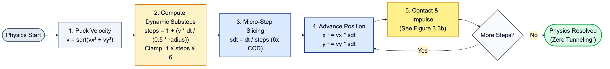  
**Figure 3.3a: Dynamic Sub-Step Time Slicing & Loop Pipeline (Mermaid Flowchart)**  
*Illustrates the dynamic micro-step calculation, time slicing ($sdt = dt / \text{steps}$), and the multi-iteration sub-stepping loop.*

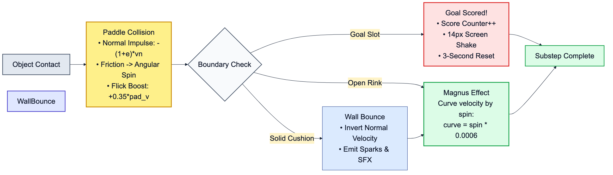  
**Figure 3.3b: Contact Impulse Resolution, Boundary Cushions & Magnus Flight (Mermaid Flowchart)**  
*Details normal impulse resolution, flick shot boosts, tangential friction spin transfer, goal slots, and Magnus curving flight.*

The number of sub-steps is dynamically calculated each frame using:
$$\text{steps} = 1 + \left\lfloor \frac{\text{speed} \cdot dt}{\text{PUCK\_R} \cdot 0.5} \right\rfloor$$
clamped between 1 and 6 steps. By advancing the simulation in micro-intervals ($sdt = dt / \text{steps}$), the puck's displacement per step never exceeds half its radius, guaranteeing 100% collision containment without tunneling.

---

### 3.4 Solo Mode: Autonomous Finite State Machine & Adaptive Learning

In Solo Mode (Single Player vs. Computer), the autonomous opponent paddle is governed by an intelligent Finite State Machine (FSM) that models realistic human player behavior. Unlike basic pong bots that directly lock their position to the puck, our Solo opponent exhibits reaction latency, tracking jitter, strike windup, and habit adaptation:

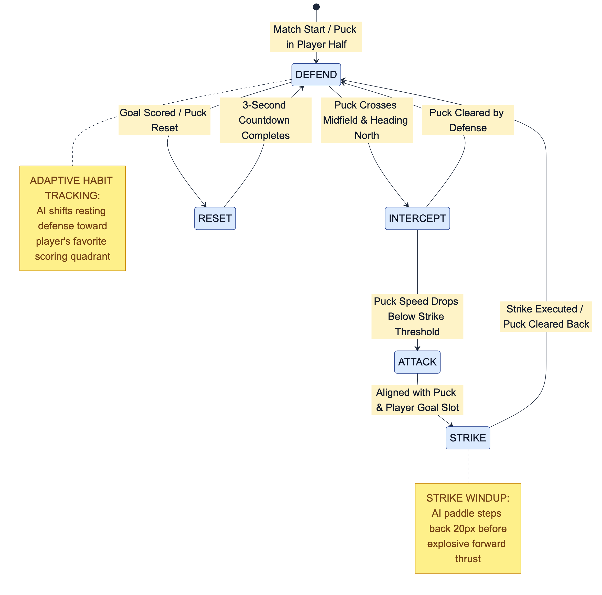  
**Figure 3.4: Autonomous State Machine & Habit Adaptation (Mermaid State Diagram)**  
*Demonstrates transitions between DEFEND, INTERCEPT, ATTACK, STRIKE (with windup), and RESET states based on court positioning and puck velocity.*

**Adaptive Habit Tracking:** The Solo opponent controller records where the player scores (left, center, or right third of the goal) and where the player prefers to take shots from. Over time, the opponent shifts its resting defensive arc toward the player's favored scoring zone, actively forcing the player to adapt their strategy.

---

## Chapter 4: Detailed Subsystem Breakdown

The project consists of 22 pairs of C source (`.c`) and header (`.h`) files totaling ~6,320 lines of code. Below is the complete engineering breakdown of each core subsystem:

### 4.1 Master Orchestrator (`src/main.c`, `src/features.h`)
`src/main.c` acts as the director of the entire game engine. It initializes the $600 \times 920$ raylib window, sets up audio and particle subsystems, loads saved disk preferences, and drives the 60 FPS game loop. It implements a finite screen state manager governing 12 screens (`SCREEN_MENU`, `SCREEN_PLAYING`, `SCREEN_HOST_WAIT`, `SCREEN_JOIN_INPUT`, `SCREEN_STATS`, `SCREEN_SETTINGS`, `SCREEN_TOURNAMENT_DIFF`, `SCREEN_TIME_ATTACK`, etc.). `src/features.h` provides compile-time feature flags (`#define FEATURE_HEATMAP 1`, etc.) allowing individual capabilities to be toggled for testing.

### 4.2 2D Physics & Predictive Trajectory Engine (`src/game.c`, `src/trajectory.c`)
`src/game.c` contains the complete physics simulation. It handles paddle acceleration ($8000\text{ px/s}^2$), friction damping, speed clamping ($1400\text{ px/s}$), boundary enforcement, elastic collisions ($\text{restitution} = 0.92$), and goal scoring. When the paddle strikes the puck with high velocity, it applies a "flick shot" momentum boost ($+0.35 \times \text{paddle\_speed}$). Tangential contact imparts angular momentum (spin), which curves the puck using the Magnus effect (cross-product acceleration perpendicular to velocity). `src/trajectory.c` raycasts 60 forward steps into the future, computing cushion reflections to draw a predictive dotted path on the court (toggled with `CTRL`).

### 4.3 Non-Blocking Cross-Platform Network Layer (`src/net.c`, `src/protocol.h`)
`src/net.c` implements real-time LAN communication using low-level cross-platform TCP sockets on port `50505` (POSIX sockets on Linux/macOS and Winsock2 on Windows). It uses non-blocking I/O (`fcntl` on POSIX, `ioctlsocket` on Windows) to ensure network I/O never blocks the frame loop. Custom `send_all()` and `recv_all()` loops handle TCP stream fragmentation, looping until full byte buffers are transferred. `src/protocol.h` defines the `Packet` struct with message types (`MSG_HELLO`, `MSG_START`, `MSG_INPUT`, `MSG_STATE`, `MSG_BYE`). The Host acts as the authoritative server, accepting client inputs and broadcasting complete world snapshots.

### 4.4 Solo Mode Opponent Engine (`src/solomode.c`)
`src/solomode.c` implements the Solo Mode autonomous opponent using a 5-state FSM (`DEFEND`, `INTERCEPT`, `ATTACK`, `STRIKE`, `RESET`). It features difficulty knobs for reaction delay, prediction quality, speed caps, and positional jitter. When attacking, it performs a realistic windup step backwards before driving forward at an angle toward the player's goal. It adapts to player scoring habits by recording player goal zones and dynamically adjusting its defensive resting stance.

### 4.5 Procedural Audio & Dynamic Tension (`src/audio.c`, `src/dynaudio.c`)
`src/audio.c` contains a mathematical audio synthesizer that creates 44.1 kHz, 16-bit PCM sound buffers in memory without requiring external `.wav` or `.mp3` files. Paddle hits, wall thuds, countdown ticks, and fanfare are synthesized using combinations of sine waves, white noise generators, and exponential decay envelopes. Collision impulse dynamically modulates sound volume and pitch. `src/dynaudio.c` smoothly ramps audio tension based on current rally length and game pace.

### 4.6 Particle Engine & Visual Themes (`src/render.c`, `src/particles.c`, `src/themes.c`)
`src/particles.c` implements a fixed 512-particle memory pool with zero runtime `malloc`/`free` calls to prevent memory leaks and garbage collection stutters. It generates yellow impact sparks, wall dust, goal confetti explosions, and fading puck motion trails. `src/themes.c` provides 4 distinct color schemes (**Neon**, **Retro**, **Dark**, **Fire**) switchable in real time with the `T` key. `src/render.c` coordinates all 2D OpenGL drawing with camera screen shake and goal flash strobes.

### 4.7 Gameplay Modifiers & Telemetry (`src/powerup.c`, `src/heatmap.c`, `src/replay.c`, `src/tournament.c`)
`src/powerup.c` manages collectible arena tokens (**Grow** paddle, **Slow** puck, **Freeze** opponent) with spawn intervals and active life timers. `src/heatmap.c` tracks puck occupancy across a $24 \times 32$ grid with exponential decay, rendering a semi-transparent court density map (toggled with `TAB`). `src/replay.c` maintains a 300-frame circular ring buffer (5 seconds at 60 FPS) enabling instant slow-motion goal replays (`V` key) and disk export (`F5`). `src/tournament.c` manages Best-of-3 and Best-of-5 competitive tournament series tracking.

### 4.8 Settings & Data Persistence (`src/settings.c`, `src/settings_ui.c`, `src/stats.c`)
`src/settings.c` handles serialization and deserialization of match parameters (win score limit, puck/paddle speeds, theme, volume) to `settings.dat`. `src/settings_ui.c` renders the interactive settings menu with sliders and toggle buttons. `src/stats.c` monitors real-time match metrics (rallies, hit accuracy, hype meter) and persists lifetime high scores (fastest puck ever, longest rally) into `airhockey.dat`.

---

## Chapter 5: Project Screenshots & Visual Evidence

The following screenshots were captured directly from the game engine during live execution. Each figure illustrates a key architectural subsystem in operation:

  
**Figure 5.1: Main Menu & Navigation Interface**  
*The main menu screen rendered at 60 FPS in raylib, providing seamless keyboard and mouse navigation across 9 menu options (Solo Mode, Local 2-Player, Host LAN, Join LAN, Time Attack, Tournament, AI vs AI Demo, Settings, and Quit).*

---

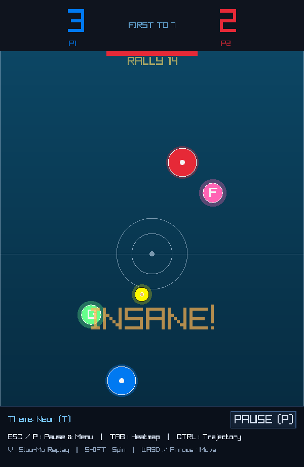  
**Figure 5.2: Real-Time Gameplay (Neon Theme)**  
*Active match rendering with the high-contrast Neon theme. Demonstrates Player 1 (blue paddle), Player 2 (red paddle), high-speed puck motion, active power-up collectible drops, score counter (3-2), and impact spark particles.*

---

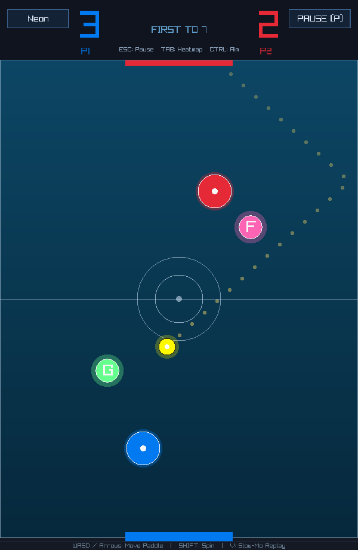  
**Figure 5.3: Predictive Trajectory Raycasting Engine**  
*Demonstrates the real-time trajectory engine (toggled via CTRL) projecting the puck's bank reflections up to 3 seconds into the future using forward raycasting and cushion normal calculations.*

---

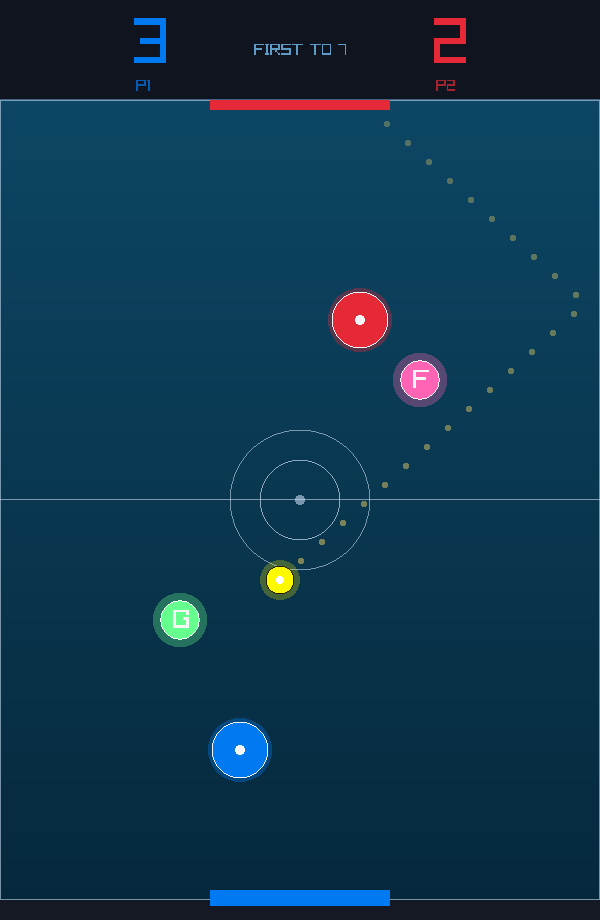  
**Figure 5.4: Territorial Puck Heatmap Density Grid**  
*Real-time analytical heatmap overlay (toggled via TAB). Visualizes a 24x32 grid tracking puck presence density across the rink with exponential decay, revealing offensive and defensive territory control.*

---

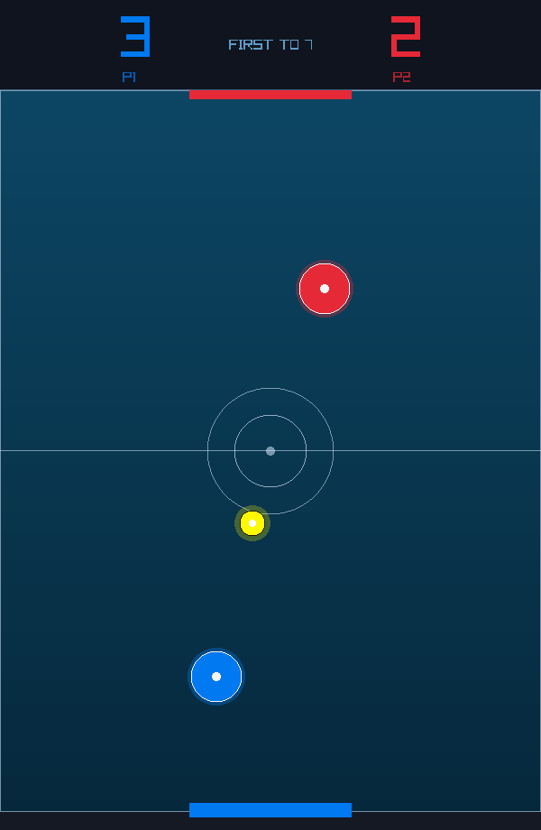  
**Figure 5.5: Post-Match Statistics & All-Time Records**  
*Comprehensive post-game telemetry screen displaying rally counters, hit-to-goal conversion accuracy, top recorded puck velocity (1120 px/s), and lifetime high-score records loaded from airhockey.dat.*

---

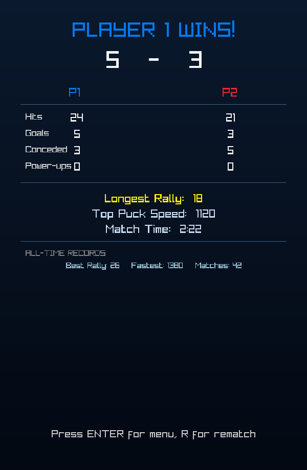  
**Figure 5.6: Time Attack Challenge Results Screen**  
*Summary screen for the 60-second Time Attack high-score mode. Displays goals scored against the clock, all-time record comparison, and triggers celebratory 'NEW RECORD!' banner notifications.*

---

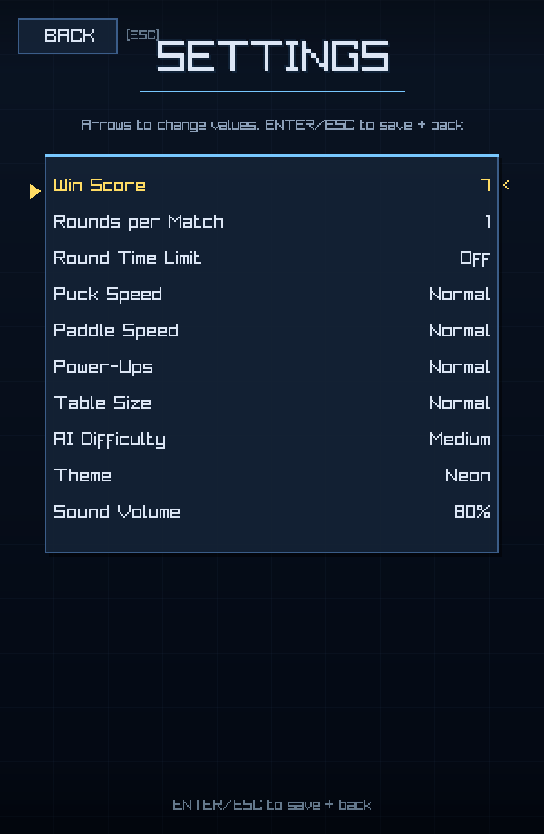  
**Figure 5.7: Interactive Configuration & Settings UI**  
*Interactive settings screen allowing players to configure winning goal limits, puck/paddle velocity multipliers, power-up spawn intervals, visual themes, and sound volume, serialized to settings.dat.*

---

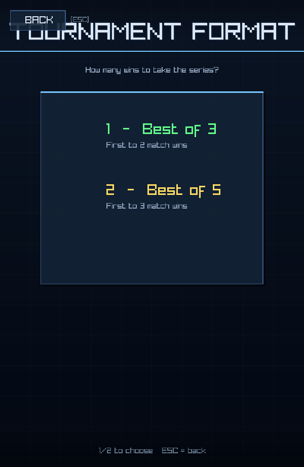  
**Figure 5.8: Tournament Format Selection (Best-of-3 / Best-of-5)**  
*Competitive tournament bracket selector enabling multi-match series play with persistent series score tracking and automated championship verification.*

---

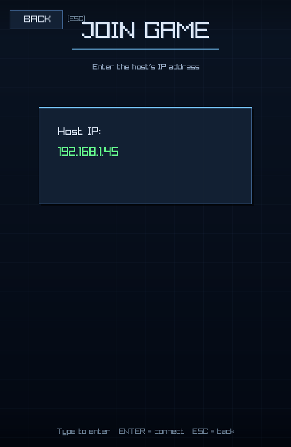  
**Figure 5.9: LAN Multiplayer 4-Digit Room Code Join Interface**  
*The modernized LAN join screen featuring automatic local UDP room beacon discovery and 4-digit Room Code pairing, eliminating manual IP typing while preserving low-level host-authoritative TCP synchronization.*

---

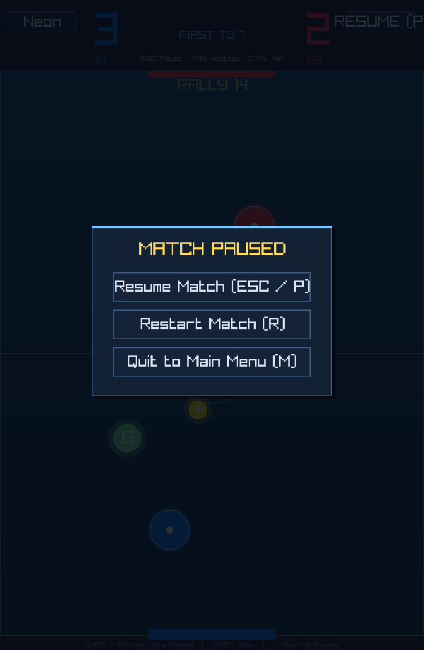  
**Figure 5.10: In-Game Pause & Navigation Modal Overlay**  
*The in-game pause system triggered seamlessly via ESC, P, or the on-screen HUD button. Displays a centered modal dialog enabling players to Resume Match, Restart Match, or safely Quit to the Main Menu while instantly freezing physics integration and countdown timers.*

---

## Chapter 6: Sample Inputs and Outputs

The table below details user input actions and the corresponding real-time engine responses:

| Input Category | User Action / Key | Engine State | System Output / Response |
| :--- | :--- | :--- | :--- |
| **Menu Navigation** | `UP` / `DOWN` Arrows | Main Menu | Cycles highlighted button with audio tick sound. |
| **Selection** | `ENTER` Key | Main Menu | Transitions to chosen screen with smooth alpha fade. |
| **Player 1 Paddle** | `W`, `A`, `S`, `D` | In-Game | Applies acceleration vector; clamped to lower half-court. |
| **Player 2 Paddle** | `Arrow Keys` | Local Play | Applies acceleration vector; clamped to upper half-court. |
| **Flick Shot** | Fast Paddle Swing | In-Game | Imparts $0.35 \times \text{paddle\_speed}$ velocity bonus boost to puck. |
| **Trajectory Line** | Hold `LEFT CTRL` | In-Game | Raycasts 60 forward steps showing bounce reflections. |
| **Heatmap Display** | Press `TAB` | In-Game | Toggles $24 \times 32$ semi-transparent density overlay. |
| **Theme Switching** | Press `T` | In-Game | Cycles palette (`Neon` $\rightarrow$ `Retro` $\rightarrow$ `Dark` $\rightarrow$ `Fire`). |
| **Instant Replay** | Press `V` | In-Game | Plays back last 300 frames in $0.35\times$ slow motion. |
| **Save Replay** | Press `F5` | In-Game | Serializes circular frame buffer to `replay.replay`. |
| **Pause / Resume** | Press `P` / `ESC` / Click HUD | In-Game | Freezes physics loop and summons Match Paused modal overlay. |
| **Restart / Quit** | Press `R` or `M` in Modal | Paused | Instantly resets match state or cleanly disconnects to Main Menu. |
| **Save Replay** | Press `F5` | In-Game | Serializes circular frame buffer to `replay.replay`. |

### 6.1 Binary Network Protocol Payloads

Raw binary socket packets exchanged between Client and Host over port `50505`:

```text
Client -> Host (MSG_INPUT Packet - 12 Bytes):
  [0x00] uint8_t type      = 3 (MSG_INPUT)
  [0x04] float   client_tx = 342.50  (Desired X coordinate for client paddle)
  [0x08] float   client_ty = 185.00  (Desired Y coordinate for client paddle)

Host -> Client (MSG_STATE Packet - 56 Bytes):
  [0x00] uint8_t type      = 4 (MSG_STATE)
  [0x04] float   p1_x, p1_y= 300.0, 700.0  (Host paddle position)
  [0x0C] float   p2_x, p2_y= 340.2, 186.1  (Client paddle position)
  [0x14] float   puck_x, y = 290.4, 450.2  (Puck coordinates)
  [0x1C] float   puck_vx,vy= 410.5,-380.2  (Puck velocity vector)
  [0x24] float   puck_spin = 12.4          (Angular momentum)
  [0x28] uint8_t score1, 2 = 5, 3          (Authoritative score)
  [0x2E] float   goal_flash= 0.0, shake=0.0(Screen effects)
```

### 6.2 Persistent Disk File Samples

Sample contents of configuration and lifetime records files:

```text
File: settings.dat (Plaintext configuration):
  7      <- win_score (goals needed to win)
  1      <- rounds (number of games in series)
  0.00   <- round_time_limit (0 = disabled)
  1      <- puck_speed (SPEED_NORMAL)
  1      <- paddle_speed (SPEED_NORMAL)
  2      <- powerups (POWERUP_NORMAL)
  1      <- table_size (SIZE_NORMAL)
  1      <- ai_difficulty (AI_MEDIUM)
  0      <- theme_idx (THEME_NEON)
  80     <- volume (80%)
  1      <- sound_on (enabled)

File: airhockey.dat (All-time records):
  26     <- best_rally_ever (longest volley)
  1380.0 <- fastest_puck_ever (px/s)
  7      <- most_goals_p1_ever
  7      <- most_goals_p2_ever
  42     <- matches_played (lifetime matches)
```

---

## Chapter 7: Hardware & Software Requirements

| Category | Minimum Specification | Recommended Specification |
| :--- | :--- | :--- |
| **Operating System** | macOS 12+ / Ubuntu 20.04+ / Linux | macOS 14+ / Debian-based Linux |
| **Processor (CPU)** | Dual-Core 1.8 GHz (x86_64 / ARM64) | Quad-Core 2.4 GHz or Apple Silicon M1/M2/M3 |
| **Memory (RAM)** | 512 MB Free RAM | 2 GB Free RAM |
| **Graphics (GPU)** | OpenGL 2.1 Compatible | OpenGL 3.3 Core / Metal Accelerated |

---

## Chapter 8: Conclusion & Future Scope

This project successfully proves that advanced, production-grade real-time systems can be developed in pure C11 without relying on heavy game engines or external media assets. By combining non-blocking cross-platform socket programming, continuous sub-stepped physics simulation, an adaptive Solo Mode state-machine opponent, and mathematical procedural waveform synthesis, the project demonstrates a comprehensive mastery of low-level systems programming, networking, and computer graphics.

Future enhancements planned for the project include:
* **NAT Punch-Through:** Implementing STUN/UDP relay protocols to allow internet play beyond local subnets.
* **4-Player Doubles Mode:** Expanding table dimensions and protocol structures to support 2 vs 2 doubles matches.
* **Mobile & Gamepad Support:** Adding support for dual analog joysticks and touch gesture inputs.

---
*Report generated and validated for MCA Project Submission.*
